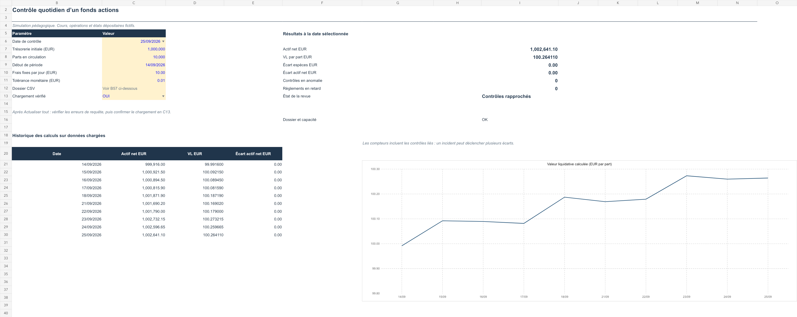

# Contrôle quotidien d'un fonds actions sous Excel

Projet pédagogique de middle office : calculer la valeur liquidative (VL) d'un fonds actions fictif, rapprocher les opérations et les soldes avec un dépositaire simulé, puis documenter les écarts.

## Ce que contient le projet

- **[Classeur Excel](Controle_fonds_actions.xlsx)** : huit feuilles pour les transactions, positions, espèces, cours, calculs, rapprochements, anomalies et tableau de bord.
- **[Données sources](Sources_projet/)** : trois jeux de CSV (`propre`, `investigation`, `extension_20260928`) et les requêtes Power Query intégrées au classeur.
- **[Guide et corrigé](Guide_du_projet.md)** : conventions comptables, mode d'emploi et exemples expliqués en français et en anglais.
- **[Rapport de vérification](Rapport_verification.md)** : résultats des tests et limites de la vérification dans Excel.

Le scénario couvre dix séances du 14 au 25 septembre 2026, cinq actions nommées, 25 transactions simulées et six dossiers d'investigation : opération manquante, doublon, quantité erronée, frais bancaires absents, cours périmé et règlement en retard. Le modèle distingue date de négociation et date de règlement, puis calcule les positions économiques, les espèces réglées, les créances et dettes en attente, les charges et la VL par part.

**Toutes les données chiffrées de cette édition publique sont fictives**, y compris les cours. Les noms des sociétés servent uniquement de repères. Ce classeur est une simulation réalisée avec l'aide d'une IA ; il ne représente ni un vrai fonds ni une expérience professionnelle.

## Ouvrir et explorer

Télécharger le dépôt, puis ouvrir `Controle_fonds_actions.xlsx` dans Microsoft Excel. La version enregistrée présente le corrigé au 25 septembre. Pour voir les six alertes, sélectionner le 24 septembre dans `Pilotage!C6` et passer les cinq corrections de la feuille `Anomalies` à `NON`.

Pour tenter une actualisation des CSV, garder le classeur et `Sources_projet` ensemble, remplacer le texte de `Pilotage!B57` par le **chemin absolu** du dossier `Sources_projet/investigation`, choisir `NON` dans `Pilotage!C13`, puis lancer **Données > Actualiser tout**. Vérifier les erreurs des requêtes avant de remettre `C13` à `OUI`.

## Vérification

Les calculs ont passé 18 tests ciblant notamment les six anomalies, les corrections, les cours manquants, les identifiants dupliqués et l'ajout d'un onzième jour. Le classeur a neuf requêtes Power Query, un tableau croisé dynamique et un graphique natif. L'exécution d'**Actualiser tout** et l'actualisation du tableau croisé dans Excel restent à vérifier sur une installation Excel locale. Les résultats préchargés peuvent être explorés sans actualisation.

This is an AI-assisted educational fund-control simulation with fully fictional numerical data. The [guide](Guide_du_projet.md) includes an English walkthrough of a purchase, a sale, settlement and NAV reconciliation.
